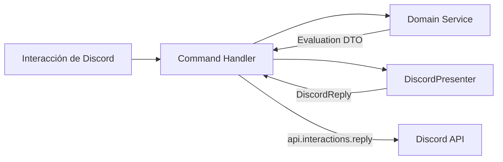

# Patrón Presenter & Arquitectura Limpia en Discord

En la inmensa mayoría de bots, los comandos mezclan todo en un solo bloque:
```typescript
// ❌ ANTI-PATRÓN COMÚN: Espagueti acoplado a Discord
client.on('interactionCreate', async (interaction) => {
  const user = await db.users.find(interaction.user.id);
  if (!user.isVip) {
    return interaction.reply({ embeds: [new EmbedBuilder().setTitle('Error').setDescription('No eres VIP')] });
  }
  // ... lógica de negocio mezclada con llamadas a Discord
});
```

Este anti-patrón hace imposible probar la lógica de negocio sin simular objetos de Discord, y romper el formato de un Embed suele romper el flujo del bot.

---

## 1. El Patrón Presenter (Modelo DDC)

Inspirado en la arquitectura de producción de **DDC**, la solución divide el flujo en 3 capas estrictamente separadas:

1. **Capa de Dominio (Domain Service)**: No sabe qué es Discord. Solo recibe datos puros y devuelve un resultado o evaluación.
2. **Capa Presenter (`DiscordPresenter`)**: Recibe el resultado de dominio y lo traduce a opciones de respuesta de Discord (`content`, `embeds`, `components`, `ephemeral`).
3. **Capa de Transporte (Command Handler)**: Solo orquesta la llamada y responde a la interacción.



---

## 2. Implementación de Referencia

### Paso 1: El DTO de Dominio (Puro TypeScript)
```typescript
export interface AccessEvaluation {
  allowed: boolean;
  code?: 
    | 'ACCESS_GRANTED'
    | 'ACCESS_DENIED'
    | 'ACCESS_MAINTENANCE_MODE'
    | 'ACCESS_POLICY_DENIED'
    | 'ACCESS_ROLLOUT_DISABLED';
  reason?: string;
}
```

### Paso 2: El Presenter de Discord
```typescript
export interface DiscordAccessReply {
  content: string;
  ephemeral: boolean;
}

export class DiscordPresenter {
  public present(evaluation: AccessEvaluation): DiscordAccessReply {
    const code = evaluation.code || 'ACCESS_DENIED';
    let title = 'Acceso Denegado';
    let message = evaluation.reason || 'No tienes autorización para realizar esta acción.';

    switch (code) {
      case 'ACCESS_MAINTENANCE_MODE':
        title = 'Servicio en Mantenimiento';
        message = 'Esta funcionalidad está temporalmente en mantenimiento. Vuelve a intentarlo más tarde.';
        break;
      case 'ACCESS_ROLLOUT_DISABLED':
        title = 'Lanzamiento Gradual Activo';
        message = 'Esta funcionalidad se está desplegando de forma gradual y aún no está disponible para tu cuenta.';
        break;
      case 'ACCESS_POLICY_DENIED':
        title = 'Restricción de Política';
        message = 'Tu cuenta no cumple con los requisitos de rol o permisos.';
        break;
    }

    return {
      content: `❌ **${title}**\n> ${message}\n\n*Código de error: \`${code}\`*`,
      ephemeral: true,
    };
  }
}
```

### Paso 3: El Handler Desacoplado
```typescript
const presenter = new DiscordPresenter();

async function handleCommand(interaction, accessService) {
  // 1. Evaluar dominio (sin dependencias de embeds)
  const evaluation = await accessService.evaluate(interaction.user.id, 'CAN_PLAY_MUSIC');

  if (!evaluation.allowed) {
    // 2. Presentar resultado
    const reply = presenter.present(evaluation);
    return interaction.reply(reply);
  }

  // 3. Proceder con el flujo normal
  return interaction.reply({ content: '✅ Acción autorizada.' });
}
```

---

## 3. Beneficios Inmediatos

* **Testeo 100% Offline**: Puedes escribir tests en Vitest para `accessService` y `DiscordPresenter` en milisegundos sin levantar conexiones a Discord ni mockear objetos `Interaction`.
* **Localización (i18n)**: El Presenter es el único lugar donde se traduce texto; si quieres soportar español e inglés, solo cambias el Presenter, la lógica de negocio queda intacta.
* **Consistencia Visual**: Todos los errores de tu bot lucen idénticos y estructurados, incluyendo códigos de error rastreables.
