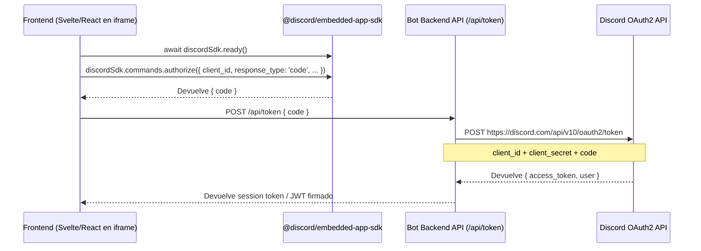

# Arquitectura de Discord Activities & Embedded App SDK

Las **Discord Activities** permiten incrustar aplicaciones web interactivas (juegos, reproductores de música, dashboards) directamente dentro de los canales de voz o texto del cliente de Discord, tanto en escritorio como en móvil.

Construir una actividad requiere entender el puente entre el cliente web (frontend), el bot (backend) y el entorno de iframe con restricciones estrictas de seguridad (CSP).

---

## 1. El Flujo de Autenticación (OAuth2 Exchange)

Dentro del iframe, la actividad no puede usar ventanas emergentes convencionales para login. Utiliza el **Embedded App SDK** de Discord:



### Implementación del Endpoint de Intercambio (Backend):
```typescript
import express from 'express';

const app = express();
app.use(express.json());

app.post('/api/token', async (req, res) => {
  const { code } = req.body;

  const response = await fetch('https://discord.com/api/v10/oauth2/token', {
    method: 'POST',
    headers: { 'Content-Type': 'application/x-www-form-urlencoded' },
    body: new URLSearchParams({
      client_id: process.env.DISCORD_CLIENT_ID!,
      client_secret: process.env.DISCORD_CLIENT_SECRET!,
      grant_type: 'authorization_code',
      code,
    }),
  });

  const oauthData = await response.json();
  // oauthData contiene: access_token, expires_in, refresh_token, scope
  res.json({ accessToken: oauthData.access_token });
});
```

---

## 2. Superando el Content Security Policy (CSP) con URL Mappings

El iframe de Discord bloquea descargas de recursos externos directos (imágenes de YouTube, avatares no aprobados, WebSockets fuera de dominio).

Para saltarte el bloqueo sin violar la seguridad:
1. En el **Discord Developer Portal**, ve a tu App → **Activities** → **URL Mappings**.
2. Configura mapeos de proxy:
   * **Prefix**: `/youtube-img` ➔ **Target**: `https://i.ytimg.com`
   * **Prefix**: `/api-ws` ➔ **Target**: `https://tu-dominio.com/socket`
3. En tu frontend, reescribe las URLs remotas para que pasen por el proxy de Discord:

```typescript
export function rewriteDiscordCspUrl(originalUrl: string): string {
  if (originalUrl.includes('i.ytimg.com')) {
    return originalUrl.replace('https://i.ytimg.com', '/youtube-img');
  }
  return originalUrl;
}
```

---

## 3. Sincronización en Tiempo Real (Rich Presence en Actividad)

Puedes reflejar en el perfil de Discord lo que el usuario está haciendo dentro de la actividad en tiempo real:

```typescript
await discordSdk.commands.setActivity({
  activity: {
    type: 2, // Listening
    details: 'Reproduciendo: Cyberpunk 2077 OST',
    state: 'En canal de voz #Música',
    timestamps: {
      start: Date.now(),
    },
    assets: {
      large_image: 'cover_album',
      large_text: 'Álbum Oficial',
    },
  },
});
```
