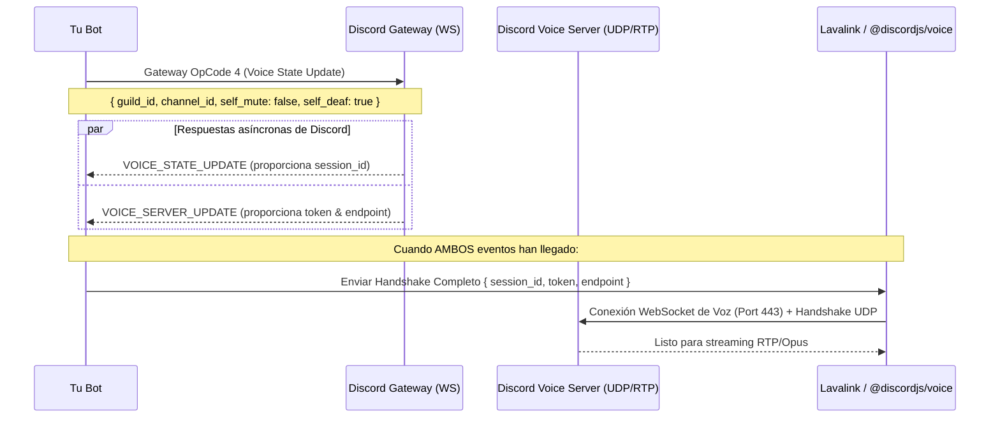

# La Anatomía del Handshake de Voz en Discord

Casi todos los tutoriales de música dicen *"usa `@discordjs/voice` y llama a `joinVoiceChannel()`"*, pero cuando el bot escala a cientos de llamadas o la región de voz de Discord migra, el bot se desconecta o la música se congela.

Entender el **Voice Handshake** a nivel de protocolo es indispensable para construir bots de audio resilientes (ya sea usando `@discordjs/voice`, Lavalink o streams UDP nativos).

---

## 1. El Flujo del Handshake de Voz

Para conectar un bot a un canal de voz, se requiere una sincronización de **dos eventos asíncronos independientes**:



---

## 2. El State Machine del Handshake

Nunca asumas el orden en que llegarán los eventos: a veces llega primero `VOICE_STATE_UPDATE`, y otras veces `VOICE_SERVER_UPDATE`.

### Implementación del Colector de Handshake:

```typescript
interface VoiceServerUpdate {
  token: string;
  endpoint: string;
  guild_id: string;
}

interface VoiceStateUpdate {
  session_id: string;
  guild_id: string;
  user_id: string;
  channel_id: string | null;
}

class VoiceHandshakeManager {
  private sessions = new Map<string, { sessionId?: string; serverUpdate?: VoiceServerUpdate }>();

  public handleVoiceStateUpdate(state: VoiceStateUpdate, botUserId: string) {
    if (state.user_id !== botUserId) return; // Solo nos importa el bot

    const guildId = state.guild_id;
    const current = this.sessions.get(guildId) || {};
    
    // Si channel_id es null, el bot fue desconectado del canal
    if (!state.channel_id) {
      this.sessions.delete(guildId);
      return;
    }

    current.sessionId = state.session_id;
    this.sessions.set(guildId, current);
    this.checkReady(guildId);
  }

  public handleVoiceServerUpdate(server: VoiceServerUpdate) {
    const guildId = server.guild_id;
    const current = this.sessions.get(guildId) || {};
    current.serverUpdate = server;
    this.sessions.set(guildId, current);
    this.checkReady(guildId);
  }

  private checkReady(guildId: string) {
    const session = this.sessions.get(guildId);
    if (session?.sessionId && session.serverUpdate) {
      // ¡HANDSHAKE COMPLETO!
      this.dispatchToAudioNode(guildId, session.sessionId, session.serverUpdate);
    }
  }

  private dispatchToAudioNode(guildId: string, sessionId: string, server: VoiceServerUpdate) {
    console.log(`✅ Handshake listo para el guild ${guildId}`);
    // Enviar a Lavalink REST API (/v4/sessions/.../players) o inicializar VoiceConnection de @discordjs/voice
  }
}
```

---

## 3. Resiliencia: Migración de Servidor de Voz en Vivo

Discord frecuentemente migra canales de voz a otros endpoints (por balanceo de carga o caída de nodos regionales).

* Cuando Discord migra un canal, emite un **nuevo `VOICE_SERVER_UPDATE`** con un nuevo `endpoint` y `token`, pero el `session_id` se mantiene.
* **Gotcha crítico**: Si destruyes el player de audio cuando esto pasa, cortas la canción. En lugar de destruir, simplemente actualiza el endpoint en tu conexión UDP. La reproducción continuará sin interrumpirse.
