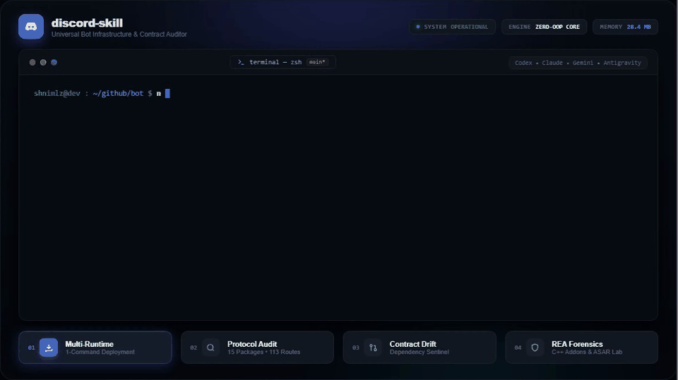

<h1 align="center">🤖 discord-skill</h1>

<p align="center">
  <a href="https://opensource.org/licenses/MIT"></a>
  <a href="https://discord.js.org"></a>
  <a href="https://github.com/features/copilot"></a>
  <a href="https://github.com/heygen-com/hyperframes"></a>
</p>

**`discord-skill`** es una suite dual de **Agent Skill (para IAs)** y **CLI de Auditoría (para desarrolladores)** diseñada para explorar, auditar y aprovechar todo el ecosistema modular de **Discord.js** y la **Discord API**.

El ecosistema de Discord.js no es solo una librería; es un monorepo masivo de componentes (`core`, `ws`, `rest`, `voice`, `builders`, `brokers`, `proxy`, `collection`, `formatters`, `discord-api-types`). `discord-skill` permite auditar cambios de contrato entre versiones, optimizar el uso de memoria y aplicar patrones arquitectónicos de alto rendimiento.

---

## 🎬 Demostración en Video

<p align="center">
  
</p>

### Previsualizar o Compilar el Video Localmente:

```bash
# 1. Previsualizar la composición interactiva en vivo con HyperFrames:
npx hyperframes preview media/hyperframes-demo

# 2. Renderizar a video determinista con HyperFrames CLI:
npx hyperframes render media/hyperframes-demo -o assets/demo.mp4

# 3. O re-grabar el video y GIF con Playwright:
node scripts/record-demo.mjs
python scripts/build-gif.py
```

---

## ⚡ Instalación en un Solo Comando (Multi-Runtime)

Instala la skill automáticamente en todos los entornos de agentes de tu sistema (**Codex**, **Claude Code**, **Gemini CLI** y **Antigravity**):

```bash
npx discord-skill install
```

O si usas el registro estándar de agent skills:

```bash
npx skills add Shnimlz/discord-skill
```

---

## 📦 Componentes del Ecosistema Cubiertos (15 Paquetes)

| Módulo                      | Descripción                                                                       |
| :-------------------------- | :-------------------------------------------------------------------------------- |
| **`discord.js`**            | Fachada principal con caché en memoria y managers de colecciones.                 |
| **`discord-api-types`**     | Especificación canónica de tipos, enums y payloads de la API de Discord (v9/v10). |
| **`@discordjs/core`**       | Cliente de bot ultra-ligero de cero sobrecarga de memoria (Zero-OOP).             |
| **`@discordjs/ws`**         | Motor de WebSocket Gateway independiente con auto-sharding y heartbeats.          |
| **`@discordjs/rest`**       | Motor de peticiones HTTP con control estricto de rate limits por bucket.          |
| **`@discordjs/builders`**   | Constructores tipados para Slash Commands, Embeds, Modals y Action Rows.          |
| **`@discordjs/voice`**      | Protocolo WebRTC/UDP de voz, cifrado y pipelines de audio (Tx/Rx).                |
| **`@discordjs/brokers`**    | Comunicación entre procesos y brokers para arquitecturas distribuidas.            |
| **`@discordjs/proxy`**      | Servidor proxy HTTP para centralizar rate limits entre múltiples procesos.        |
| **`@discordjs/collection`** | Estructuras de datos avanzadas (Map extendido y LRU Sweepers).                    |
| **`@discordjs/formatters`** | Utilidades de formateo para timestamps interactivos y menciones de Discord.       |
| **`@discordjs/rpc`**        | Rich Presence en escritorio mediante sockets IPC locales.                         |
| **`@discordjs/structures`** | Modelos y estructuras desacopladas de clientes globales.                          |
| **`@discordjs/util`**       | Bitfields de alta velocidad y validadores compartidos.                            |
| **`next`**                  | Seguimiento continuo de la próxima gran versión (v15 / canary).                   |

---

## 🚀 Uso del CLI para Desarrolladores

```bash
# 1. Auditar el catálogo completo de componentes y métricas del protocolo
pnpm cli audit

# 2. Comparar dependencias contra la línea base de la skill (detectar drift)
pnpm cli diff ../tu-proyecto/package.json

# 3. Congelar o actualizar la línea base (baseline)
pnpm cli baseline

# 4. Laboratorio de ingeniería inversa con REA
pnpm cli rea
```

---

## 🧠 Como Agent Skill (Antigravity, Claude Code, Cursor, Codex)

Este repositorio incluye una especificación de skill en:
[`.agents/skills/discord-skill/SKILL.md`](.agents/skills/discord-skill/SKILL.md)

Las IAs pueden cargar esta skill para:

- Recomendar la separación entre `@discordjs/core` y `discord.js` para reducir consumo de RAM.
- Guiar la implementación de pipelines de **Voice Receive** con Opus y STT (Whisper).
- Detectar rutas y eventos nuevos de Discord antes de que salgan en tutoriales públicos.
- Asegurar que no se llamen endpoints restringidos a usuarios (`Bot Token` safety boundaries).

---

## 🤝 Contribuciones de la Comunidad

¡Buscamos la colaboración de todos los creadores de bots!

- ¿Encontraste un endpoint indocumentado o experimental?
- ¿Quieres aportar un extractor AST más profundo para `@discordjs/voice` o `@discordjs/brokers`?

Revisa [CONTRIBUTING.md](CONTRIBUTING.md) para enviar tu Pull Request.

---

## 📄 Licencia

MIT © 2026 Shnimlz & Discord Bot Developers Community.
